# Switch your Piso WiFi vendo to pisowifi

This guide moves an existing Piso WiFi vendo (LPB or similar) onto pisowifi,
step by step. You don't need to know Linux. If you can copy and paste, you can
do this.

**Time:** about 45 minutes. **Cost:** one new microSD card (around ₱200–₱400).

> **Your old software stays safe.** You'll put pisowifi on a *new* microSD
> card and keep your old card in a drawer. If anything goes wrong, put the old
> card back in and your vendo is exactly as it was.

## What you need

- **Your vendo.** It must have an **Orange Pi One** board inside (look for
  "Orange Pi One" printed on the board). Other boards aren't supported yet.
- **A new microSD card,** 16 GB or bigger. Class 10 / A1 is best.
- **A card reader** for your computer, if it has no SD slot.
- **A computer** (Windows or Mac) on the same modem as the vendo.
- **Your phone.**
- **Internet on the modem,** because the installer downloads two small tools.

Here's how everything connects. **You don't move any cables.** The vendo
already has this wiring from your old software:

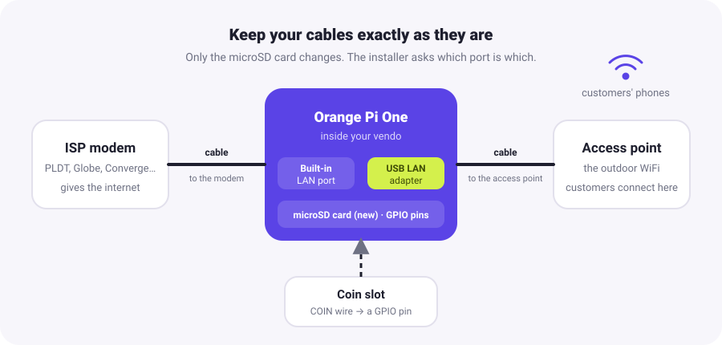

---

## Step 1. Put Armbian on the new microSD card

Armbian is the free operating system pisowifi runs on.

1. On your computer, open [armbian.com/orangepi-one](https://www.armbian.com/orangepi-one/).
2. Download the **Debian (Bookworm) Minimal / IoT** image.
3. Install [balenaEtcher](https://etcher.balena.io/) (free).
4. Put the new microSD card in your computer. Open balenaEtcher, choose the
   Armbian file you downloaded, choose the microSD card, and click **Flash**.
   Wait until it says it's done.

## Step 2. Swap the cards and start the vendo

1. **Unplug the vendo's power.**
2. Take out the old microSD card. **Label it "OLD"** and keep it somewhere safe.
   It's your way back.
3. Put the new card in.
4. Plug the power back in. Wait **2 minutes** while it starts for the first
   time.

## Step 3. Connect to the vendo from your computer

1. **Find the vendo's address.** Open your modem's admin page (often
   `192.168.1.1`) and look at the list of connected devices for
   **orangepione**. Write down its address, like `192.168.1.23`. A free phone
   app like *Fing* also shows it.
2. **Open a terminal.**
   - Windows: press **Start**, type **PowerShell**, and open it.
   - Mac: open **Terminal**.
3. Type this, using your vendo's address, and press Enter:

   ```bash
   ssh root@192.168.1.23
   ```

   Type `yes` if it asks whether to continue. The first password is **1234**.
   Armbian then asks you to make a new password and a user account. Follow its
   questions, and **remember the new password**.

## Step 4. Download pisowifi and check the vendo

Copy and paste these lines one at a time (in PowerShell or Terminal, right-click
pastes). The first one downloads pisowifi from the official releases page.

```bash
wget https://github.com/cplus2jules/pisowifi-releases/raw/main/v0.2.2/pisowifi-armv7.tar.gz
```

(If it says `wget: command not found`, use
`curl -LO` followed by the same address instead.)

```bash
tar xzf pisowifi-armv7.tar.gz && cd pisowifi
```

```bash
sudo ./preflight.sh
```

> A newer version may be out. Check the folders on
> [pisowifi-releases](https://github.com/cplus2jules/pisowifi-releases) and
> change `v0.2.2` to the newest one. (Installing an older one is fine too:
> the vendo updates itself from the dashboard later.)

The check changes nothing. It should end with **"No problems … OK to run
./install.sh"**. A `WARN` about the time zone is normal; the installer fixes it.
If you see a `FAIL` line, stop there and ask for help (see the end of this guide).

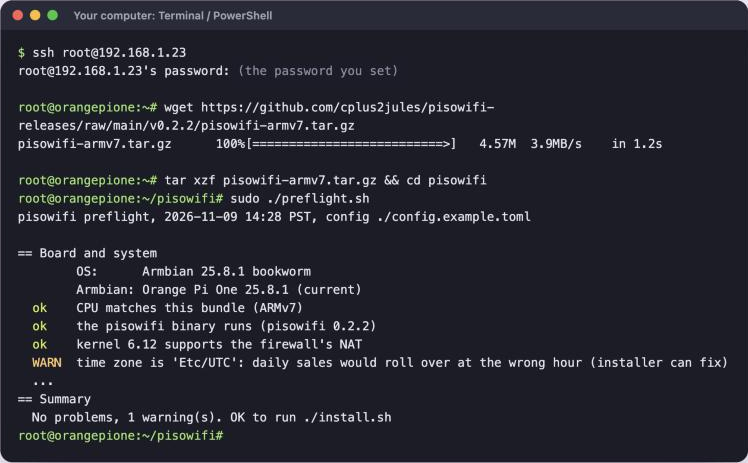

## Step 5. Run the installer

```bash
sudo ./install.sh
```

It asks a few questions. Here's what to answer.

**"I have a backup of the SD card. Continue?"** Type `y`. Your old card in
the drawer is your backup.

**Which port is which.** The vendo has two network ports, and the installer
lists them:

- The **built-in** port usually starts with `end` or `eth`, like `end0`. It
  goes to the **modem**.
- The **USB adapter** usually starts with `enx`, like `enx00e04c112233`. It
  goes to the **access point** (customers).

Type each name when asked, then `y` to confirm. When it offers to set up the
network, type `y`.

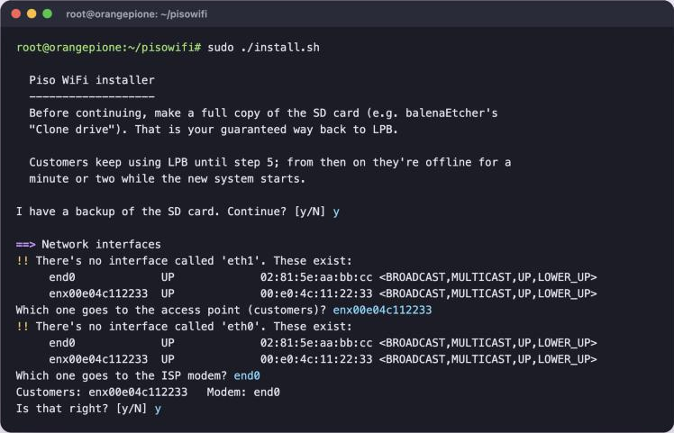

**Your dashboard password.** This is the password *you* use to manage the
vendo. Make it long, like 4 random words (`mango tricycle lamp ocean`). Don't
reuse your old vendo password.

**Write down the "Fingerprint" line.** You'll use it in Step 7 to make sure
you're really talking to your vendo.

**Your phone's WiFi address (MAC).** This locks the owner dashboard so only
your phone can open it. Customers can't even see the sign-in page.

- **iPhone:** Settings → Wi-Fi → tap ⓘ next to your vendo's WiFi → turn
  **Private Wi-Fi Address** off. The **Wi-Fi Address** is shown right there.
- **Android:** Settings → Wi-Fi → tap your vendo's WiFi (or its ⚙) →
  **Privacy** → **Use device MAC**. The address is under **Advanced** or
  **Device MAC address**.

It looks like `a4:5e:60:11:22:33`. Type it in. (You can press Enter to skip
and add it later, but then anyone on the WiFi can reach the sign-in page.)

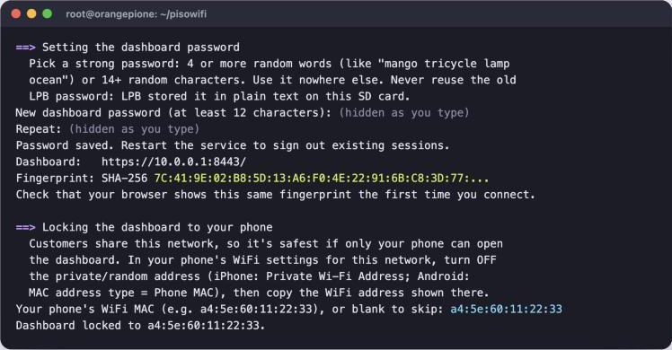

**"Set the time zone to Asia/Manila?"** Type `y`.

**Finding the coin slot.** Type `y` to run the coin probe, then **drop a few
coins** in the slot. Each coin prints a line ending in `line = 12` (your
number may differ). Press **Ctrl + C** when done, then type that number.

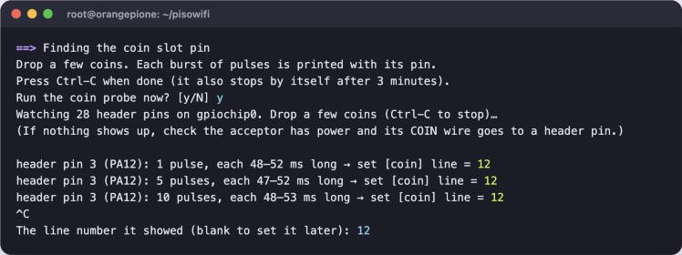

> **No lines appear when you drop coins?** Check the coin slot has power and
> that its COIN wire is still on the Orange Pi's pins. If it worked with your
> old software, the wiring is fine; just keep it. Never connect a wire that
> carries 5 V or 12 V straight to a pin. The README's
> [wiring section](../README.md#wiring-the-coin-slot-read-this-before-plugging-anything-in)
> explains how to check.

When it says **"Done. Customers can use the WiFi again."**, type
`sudo reboot`. The vendo restarts and your terminal disconnects. That's
expected.

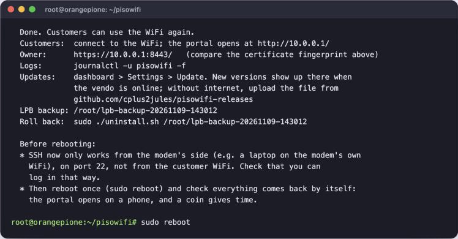

## Step 6. Test it like a customer

Give the vendo a minute after the restart, then on your phone:

1. Connect to the vendo's WiFi. The **customer page** opens by itself. If it
   doesn't, open `http://10.0.0.1` in your browser.
2. First-time visitors get a short welcome. Tap **Skip** or **Next**.
3. Tap **Insert coin**, drop a coin, and tap **Start internet**.

| First visit | Dropping coins | Online |
|---|---|---|
| 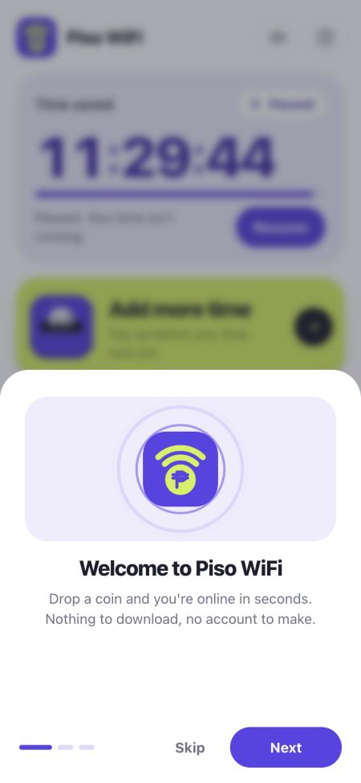 | 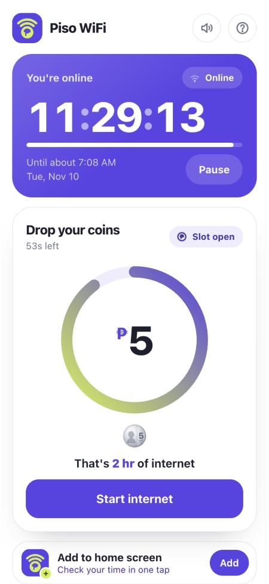 | 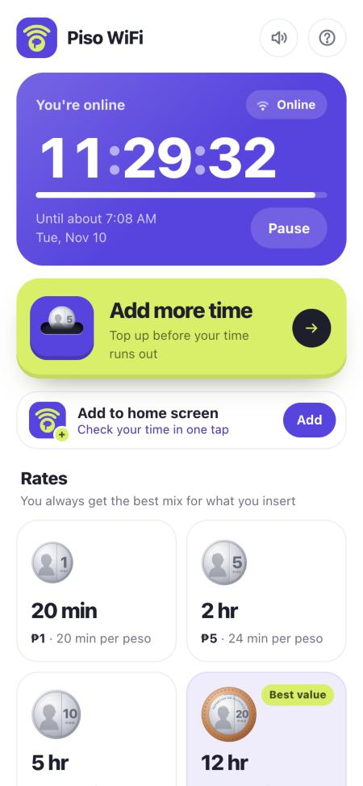 |

If the coin gives time and the internet works, **your vendo is running
pisowifi.** 🎉

## Step 7. Open your owner dashboard

On **your phone** (the one whose address you gave the installer), open:

```
https://10.0.0.1:8443
```

Your browser will warn that the connection isn't private. That's normal for a
vendo: its security certificate is made by the vendo itself, not bought from a
company. Tap the warning's details and check that the certificate's
**SHA-256 fingerprint** matches the one you wrote down in Step 5. If it
matches, tap **Advanced** → **Proceed**. You only do this once.

Sign in with the dashboard password from Step 5.

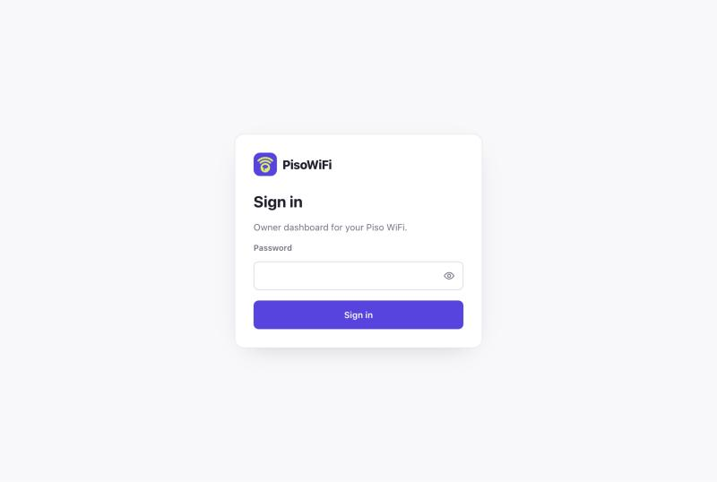

The **Dashboard** shows today's earnings, who's online, the coin box and the
vendo's health:

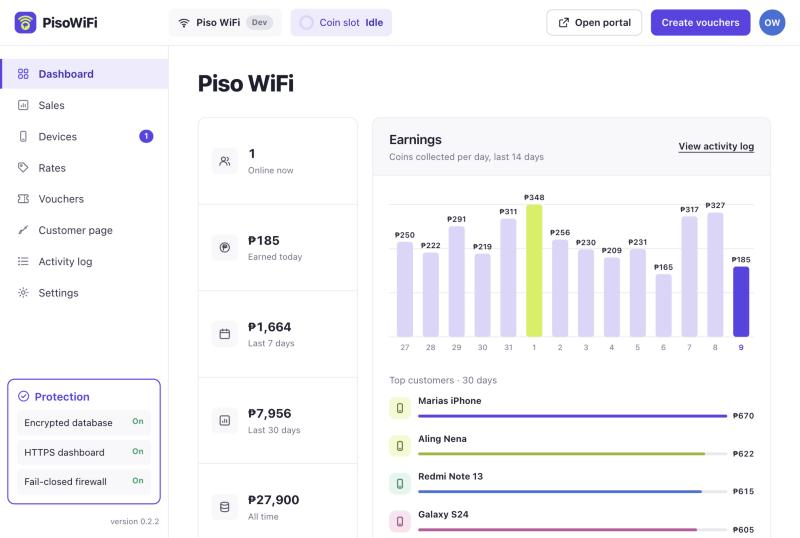

## Step 8. Set it up your way

**Rates.** Set how many minutes each peso amount buys, and tap the coins your
coin slot takes. Customers always get the best mix for what they drop.

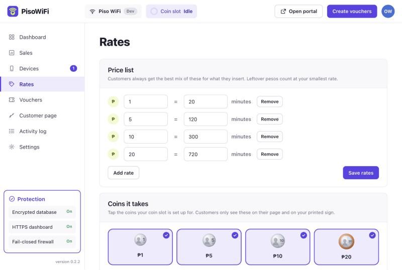

**Customer page.** Your shop name, colours, logo, a message for customers, and
the look: **Classic** or **Glass**.

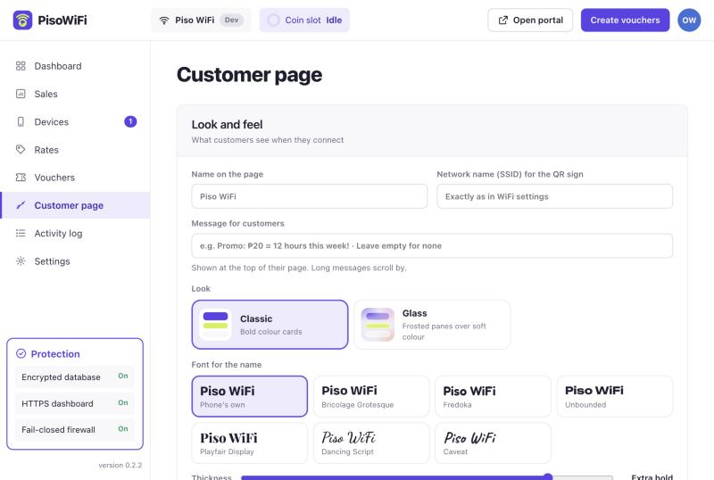

| Classic | Glass |
|---|---|
|  | 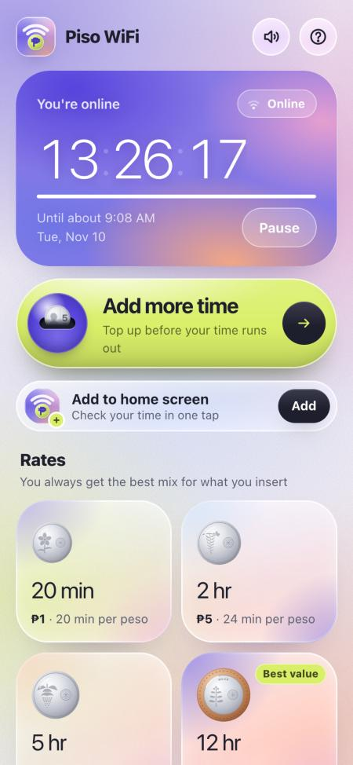 |

**Printable sign.** Further down the Customer page. Tap **Shuffle** until you
like a design, add your logo, then **Print** it or save it as a **PNG** or
**PDF**. Stick it on the vendo: customers scan it to join the WiFi and open
your page.

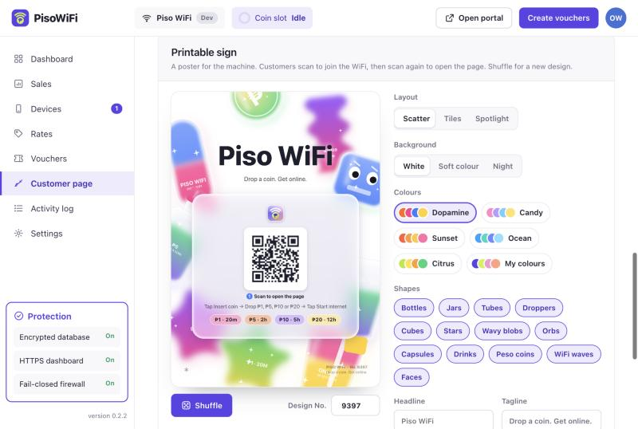

**Updates.** New versions show up in **Settings → Update** when the vendo has
internet. Tap install, and customers stay online while it updates. A version
that doesn't start properly is undone by itself.

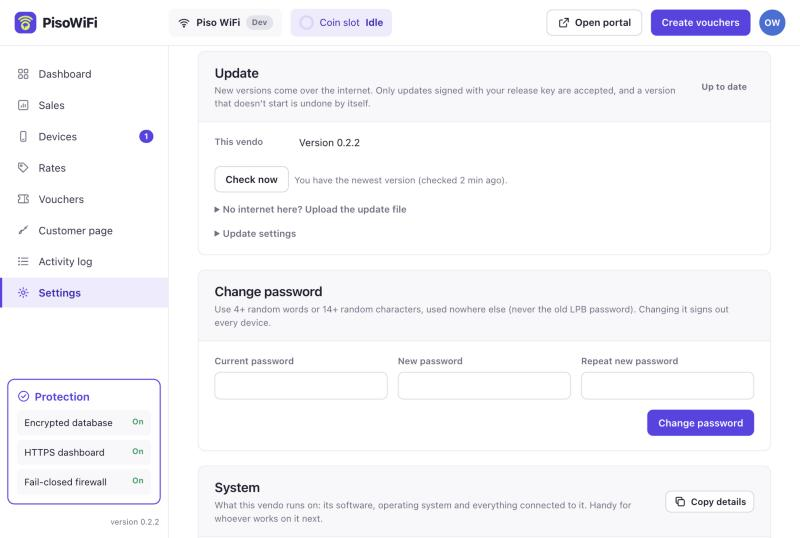

---

## If something goes wrong

| Problem | What to do |
|---|---|
| I want my old software back | Unplug the power, put the **OLD** card back in, plug in. Done. |
| `ssh` says "connection refused" or nothing happens | Wait another minute after starting. Check the vendo's address on the modem again. Make sure your computer is on the **modem's** network, not the vendo's WiFi. |
| I forgot the Armbian password from Step 3 | Flash the card again (Step 1) and start over. Nothing is lost yet. |
| The customer page doesn't open | Open `http://10.0.0.1` yourself. If that fails too, the two ports may be swapped: sign in with `ssh` from a computer on the modem's network and run `cd pisowifi && sudo ./install.sh --full` to answer the port questions again. |
| Coins don't give time | In `ssh`, run `sudo systemctl stop pisowifi && sudo pisowifi coin-probe`, drop a coin, and set the line number it shows in `/etc/pisowifi/config.toml` under `[coin]`. Then `sudo systemctl start pisowifi`. |
| The dashboard says the device isn't allowed | Your phone is using a private (random) WiFi address. Turn it off for this WiFi (see Step 5). The locked page also shows the address to allow. |
| I forgot my dashboard password | In `ssh`, run `sudo pisowifi set-password`. |
| No modem yet, just want to try it | Run `sudo ./install.sh --test-layout` instead (see the [README](../README.md#install-on-the-orange-pi)). |

**Make a backup** once everything works, and again whenever you change rates:

```bash
sudo pisowifi backup --out /root/pisowifi-backup.db
```

Copy that file off the vendo (for example with WinSCP on Windows). Your sales
and settings are locked to this exact board, so this backup is how you move
them to a replacement board.

**Still stuck?** [Open an issue](https://github.com/cplus2jules/pisowifi/issues)
with what you tried and the output of `sudo ./preflight.sh`. Never post your
passwords.
